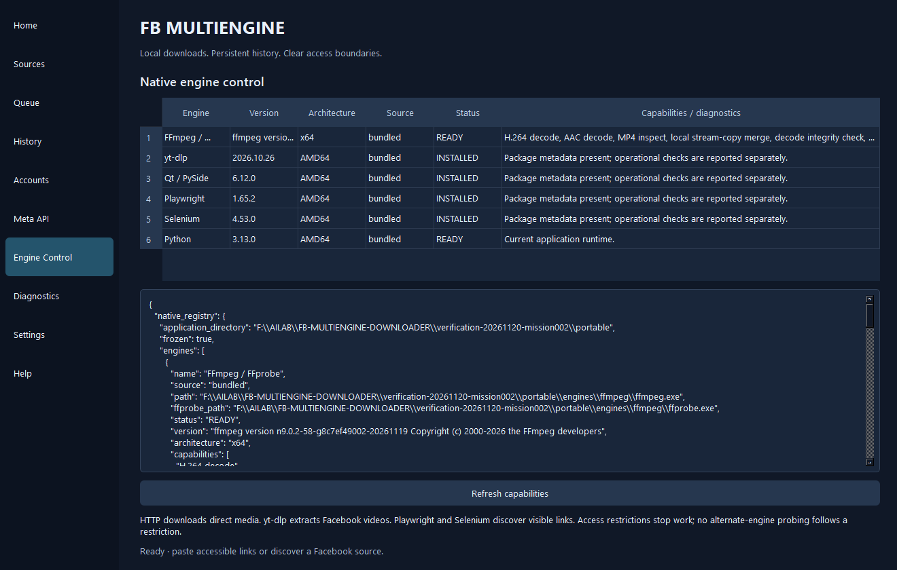
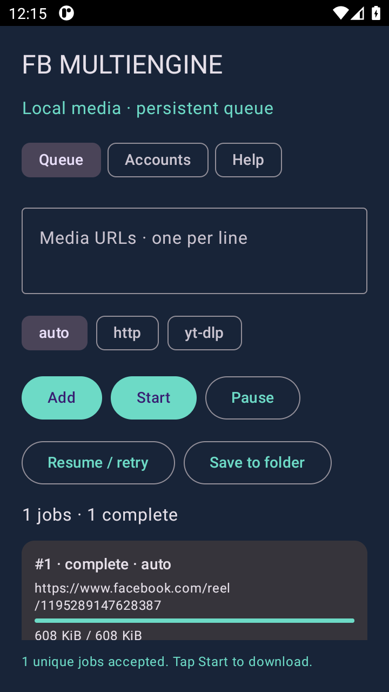

# FB MultiEngine Downloader

An independent local media downloader for Windows, Android and Python. Alpha release: **0.2.0-alpha.1 — integrated native engines**. The [verification report](evidence/VERIFICATION.md) identifies the tested artifacts, results and remaining limits.

## What it does

- Windows: PySide6 interface, visible-link discovery with Playwright or Selenium, HTTP and yt-dlp downloads, persistent queue/history, pause/resume, cancellation, content hashes and duplicate prevention.
- Android: Kotlin/Compose UI, native on-device HTTPS and yt-dlp downloads, foreground service, SQLite queue, Android Keystore and Storage Access Framework export. Bundled FFmpeg enables merging only after its on-device fixture test passes; profile discovery and browser-session extraction are desktop-only.
- Python: installable wheel, `fbmd` CLI and typed `fbmd.client.Downloader` API. Optional authenticated loopback API; remote downloader services and LAN listening are disabled.

Access restrictions stop processing. The app does not defeat authentication, CAPTCHA, account restrictions or private-content permissions. Only save media you are permitted to archive.

## Windows

Use the Windows installer, or extract the entire portable ZIP and launch `FBMD.exe`. Keep `_internal` and `engines` alongside it. Python, Qt, FFmpeg, FFprobe, the required multimedia DLLs, Chromium, matching ChromeDriver and extractor libraries are included. No PATH changes or separate runtime installation are required. Media defaults to `F:\AILAB\FB-MULTIENGINE-DOWNLOADER` when that drive is available, otherwise your Downloads folder. Choose another destination in Settings. Uninstall removes program files and preserves personal state and media.

Paste video URLs on Home, add them, then press Start. Sources scans profile/Page URLs; Index only is enabled initially. Accounts requires explicit consent before saving a dedicated browser session. Existing browser profiles are never read automatically.

Engine Control probes the bundled FFmpeg and FFprobe executables, codecs and containers before reporting READY. Local split-stream merging, HLS processing, stream inspection and decode checks use this runtime. Settings permits an advanced external override; a broken override is reported rather than silently replaced. Bundled Chromium handles browser discovery; Selenium uses the matching bundled driver. Engine and browser updates arrive with application releases.

## Python

```powershell
python -m pip install .\fb_multiengine_downloader-0.2.0a1-py3-none-any.whl
fbmd doctor
fbmd provision-native
fbmd engines
fbmd add "https://www.facebook.com/reel/VIDEO_ID"
fbmd run
fbmd list
fbmd pause
fbmd resume
fbmd export manifest.json
```

The wheel keeps native provisioning explicit: `fbmd provision-native` downloads the checksum-pinned Windows x64 FFmpeg/FFprobe bundle into application-controlled storage. It does not modify system PATH. `fbmd inspect FILE`, `fbmd merge VIDEO AUDIO OUTPUT` and `fbmd native-test NEW_DIRECTORY` expose local media operations. Browser dependencies remain optional for the wheel: install `playwright selenium`, and install Chromium with `python -m playwright install chromium` if Edge is unavailable. Use `fbmd discover "PROFILE_URL" --rounds 20 --enqueue`; without `--enqueue`, discovery is index-only. `fbmd login --save-session` explicitly saves the dedicated session. Global `--state`, `--media`, `--account` and `--report` precede the subcommand.

```python
from fbmd.client import Downloader
app = Downloader("./local-state", "./media")
app.enqueue("https://example.org/authorized-media.mp4")
results = app.run()
```

On Linux/macOS, a secure OS keyring is required; these platforms have not been release-tested in this mission.

## Android

Install the APK from the verified release. Share a video URL to FB MultiEngine or paste it, add it, and tap Start. Downloads stay on the device. Use Save to folder to copy completed files to a location selected through Android's system picker. Internal app files are removed on uninstall; export them first. No desktop service is required.

The universal package contains ARM64 and x86_64 native libraries. Engines displays the result of a local FFmpeg version/merge/track/decode test. An unavailable native runtime leaves progressive downloads available and is reported clearly. Release execution was tested on an x86_64 Android emulator; ARM64 libraries receive static ABI/dependency inspection. No physical ARM64 execution is claimed.

## API and credentials

Install the `api` extra or `fastapi uvicorn`, then run `fbmd serve`. It binds only to `127.0.0.1:8765`. Every endpoint requires a Bearer token; `fbmd api-token --reveal` explicitly displays the generated local token. The token is otherwise encrypted. An authenticated `/openapi.json` describes the contract. Do not expose this alpha through a reverse proxy.

Windows credentials use Fernet encryption with the key protected by current-user DPAPI. Android uses AES-GCM with Android Keystore. URLs containing signed query parameters are encrypted in the queue. Exports omit query strings and all credential values. Each Windows account label has separate state and credentials. No password collection or Meta App Secret storage is implemented.

Meta integration can probe an existing authorized token and explicitly supplied object. OAuth requires a configured, reviewed app and is unavailable here. The current `video_reels` reference does not support reads. See [Meta limits](docs/META_API.md) and [research](docs/ENGINE_RESEARCH.md).

## Limits and evidence

Discovery is bounded and coverage is uncertain. The supplied profile yielded 73 visible links using an explicitly saved app session; two selected media items downloaded with audio and video. This is not proof of complete coverage. A separate public Reel was downloaded on all three products; its delivered progressive file is video-only. Generated split-stream fixtures separately verify merging and audio presence. Date/duration filters, OAuth onboarding, automatic LAN pairing and global cross-account concurrency are not implemented in this alpha. Meta authentication remains unverified without a configured app/token.





See [build instructions](docs/BUILD.md), [native engines](docs/NATIVE_ENGINES.md), [architecture and recovery](docs/ARCHITECTURE.md), [security](docs/SECURITY.md), and [third-party notices](docs/THIRD_PARTY.md). Release assets include SHA-256 checksums and corresponding source material. Keep session state, downloaded media and signing keys out of source control. Windows builds are unsigned; Android uses the project's release signing key.
